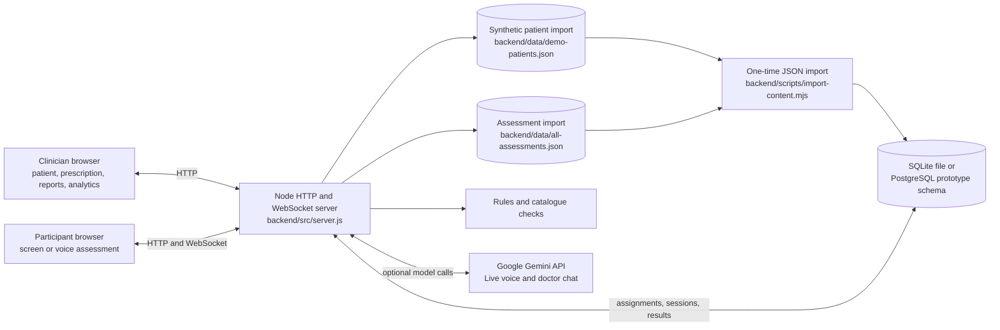
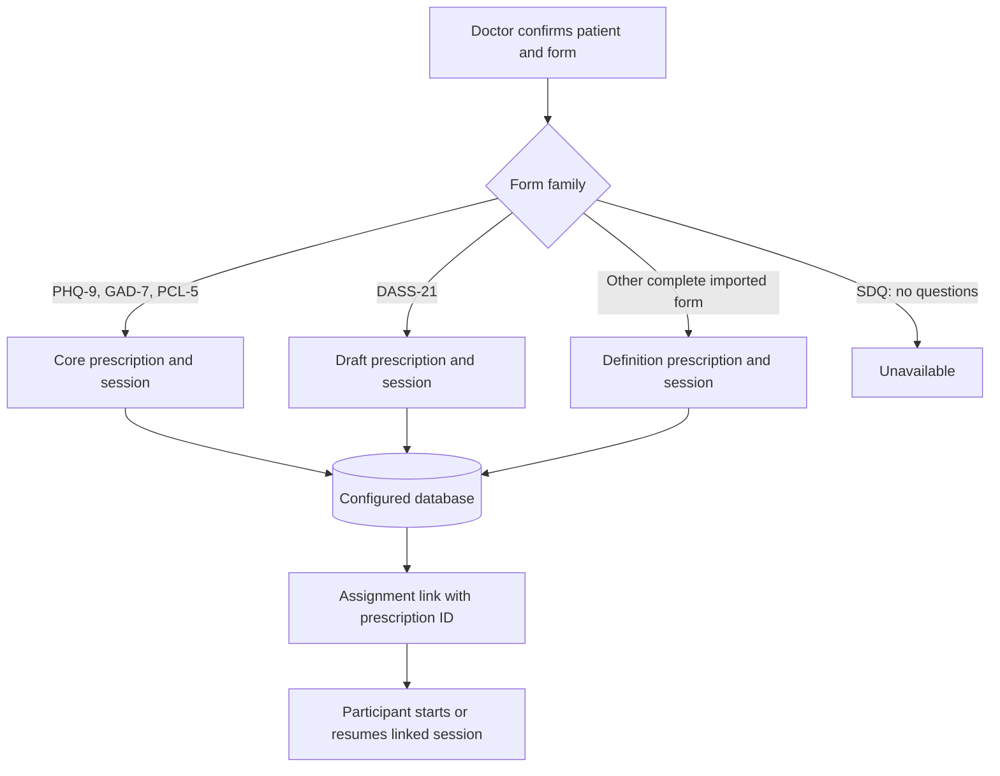
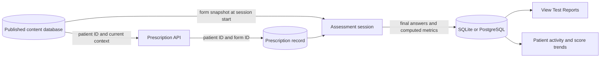

# Prototype architecture and workflows

**Applies to:** the standalone `D:\phq9-gemini-live-prototype` application as implemented on 17 November 2026. It describes the local demonstration, not the deployed Casebook product. Start and configuration steps are in the [README](../README.md).

## System at a glance



The browser does not connect directly to the database or Gemini. The server owns assessment validation, answer persistence, deterministic scoring, and Gemini connections. The microphone and optional camera stream to the server over a local WebSocket; video provides conversational context and is never an input to scoring. The application saves recorded answers and derived results, not an audio or video recording.

| Area | Implementation | Source of truth |
| --- | --- | --- |
| Clinician UI | `frontend/src/pages/ClinicPage.jsx`, `frontend/src/controllers/clinic.js`, `frontend/src/controllers/analytics.js` | API responses |
| Sample patient profiles and summaries | `backend/src/demo-patients.js`, `backend/src/content-db.js` | Database `content_patients`; JSON is a one-time import source |
| Core recommendation shortlist | `backend/src/recommendation.js`, `backend/src/assessment-catalog.js` | Current structured observations and four curated entries |
| Doctor conversation | `backend/src/doctor-chat.js` | De-identified current observations, message, keyword-retrieved candidates, Gemini response checked against those candidates |
| Questionnaire catalogue | `backend/src/content-store.js`, `backend/src/assessment-source.js`, `backend/src/definition-library.js`, `backend/src/draft-library.js`, `backend/src/forms.js` | Versioned database `assessment_versions`; core IDs are normalized in code |
| Assessment sessions and reports | `backend/src/store.js`, `backend/src/draft-store.js`, `backend/src/definition-store.js`, `backend/src/postgres-stores.js` | Configured SQLite or PostgreSQL database |
| Voice bridge | `backend/src/gemini-bridge.js`, `backend/src/definition-voice.js` | Gemini Live and server-side answer validation |
| Score calculations | `backend/src/assessment.js`, `backend/src/draft-scoring.js`, `backend/src/definition-scoring.js` | Deterministic code and the assigned form snapshot |

## 1. Patient selection and assessment recommendation

```mermaid
sequenceDiagram
    actor Doctor
    participant UI as Prescribe Test UI
    participant API as Node API
    participant DB as Content database
    participant Rules as Recommendation rules
    participant Gemini as Gemini text model
    Doctor->>UI: Select patient
    UI->>API: GET /api/demo-patients/{id}/recommendations
    API->>DB: Read summary and observation status
    API->>Rules: Map current codes; apply safety, age and trauma checks
    Rules-->>API: Ranked shortlist with reasons and evidence
    API-->>UI: Summary, primary suggestion, allowed choices
    opt Doctor conversation
        Doctor->>UI: Send de-identified note
        UI->>API: POST /api/demo-patients/{id}/doctor-chat
        API->>API: Retrieve keyword-matched catalogue candidates
        API->>Gemini: Current context, note and candidate IDs
        Gemini-->>API: Up to three IDs and reasons
        API->>API: Reject IDs outside candidate set
        API-->>UI: Suggestions for doctor review
    end
    Doctor->>UI: Choose assessment and confirm assignment
```

The content database contains five synthetic summaries imported from `backend/data/demo-patients.json`. `backend/src/demo-patients.js` maps only **current** reviewed observations to depression, anxiety, trauma-related symptoms, or stress; historical observations remain visible as ignored evidence. The fixed shortlist can suggest PHQ-9, GAD-7, PCL-5, or DASS-21. PCL-5 requires documented trauma-related symptoms and confirmed qualifying exposure. Unreviewed safety status or a safety concern pauses suggestions. The doctor can choose a runnable form from the full searchable catalogue and confirms the prescription.

Doctor conversation is **not vector RAG**. It combines token-based retrieval from available imported definitions and the four dedicated forms with a text-model suggestion, then checks returned IDs against that candidate set. If the model call fails, a labelled local keyword fallback is used. It does not create or approve scoring rules. Conversation history stays in browser memory for this demo; the request sends de-identified notes to Gemini and is not saved as a patient record.

## 2. Prescription and assessment type



The 16 November bundle has 186 entries; 185 have usable question-and-answer structures. PHQ-9, GAD-7, PCL-5, and DASS-21 retain dedicated flows. Other available forms use the generic definition flow for choice, multiple choice, number, integer, and text answers. SDQ remains visible but cannot be prescribed because its source record has no questionnaire. An assessment session stores a **snapshot** of its assigned form so later imports do not silently change earlier results.

## 3. Participant voice and screen workflows

```mermaid
sequenceDiagram
    actor Participant
    participant Browser as Assessment browser
    participant API as Node WebSocket and API
    participant Live as Gemini Live bridge
    participant DB as Session store
    participant Score as Deterministic scorer
    Browser->>API: Open assignment and start session
    API->>DB: Load prescription and form snapshot
    API-->>Browser: Current exact item and response anchors
    alt Voice conversation
        Participant->>Browser: Speak answer; optional camera context
        Browser->>API: 16 kHz PCM and optional JPEG frames
        API->>Live: Stream media and exact item
        alt Response maps to a permitted answer
            Live-->>API: record_answer(item, value, summary)
            API->>API: Check current item and permitted value
            API->>DB: Save recorded answer
            API-->>Browser: Advance to next eligible item
        else Response is unclear
            Live-->>Participant: Ask a neutral follow-up
        end
    else Complete on screen
        Participant->>Browser: Select or enter answer
        Browser->>API: Submit validated response
        API->>DB: Save response
    end
    Browser->>Participant: Review and edit all answers
    Participant->>Browser: Confirm final answers
    Browser->>API: Finish session
    API->>Score: Calculate supported metrics from final answers
    Score-->>API: Scores or withheld reasons
    API->>DB: Save completion and result
    API-->>Browser: Common report view
```

The question display and report shell share a consistent layout across the dedicated and generic flows. Response widgets vary with the form's actual answer type. Gemini interprets natural language and may ask a follow-up when an answer is unclear; only server-validated values are saved. Final review can change values before deterministic scoring. Camera frames cannot set an answer or score. Audio and video are not retained by the database.

### Scoring by form family

| Form family | Current calculation | Report behavior |
| --- | --- | --- |
| PHQ-9 | Nine responses, total 0–27; severity bands and an independent item-9 follow-up flag | Score, answers, printable report |
| GAD-7 | Seven responses, total 0–21 and configured bands | Score, answers, printable report |
| PCL-5 | Twenty responses, total 0–80 | No invented severity band or diagnosis |
| DASS-21 | Raw total, raw and doubled depression/anxiety/stress subscales | Separate subscales and answers |
| Imported definitions with rules | `sum`, `mean`, `count_threshold`, or `weighted_sum` over the form's specified items and source values | Draft raw metrics or a reason a metric was withheld |
| LEC-5 and asQ | No numeric rule in supplied bundle | Answer report; no fabricated total |

The generic evaluator validates answer type and range, applies conditional display and context rules, and withholds a metric when a required answer, source numeric value, or eligibility context is missing. For BAM Continuous, it computes separate Substance Use, Risk Factors, and Protective Factors composites; its numeric skip logic is covered by a regression test. The imported bundle marks all 186 forms' scoring disabled for clinical use. These calculations are workflow demonstrations, not verified NovoPsych report equivalents. See the [source gap audit](NOVOPSYCH_20261116_GAP_AUDIT.md).

## 4. Persistence, reports, and analytics



| Storage mode | Records |
| --- | --- |
| SQLite default | `backend/data/content.sqlite` holds versioned definitions, metadata, and sample patients; `backend/data/prototype.sqlite` holds assignments and sessions |
| PostgreSQL when `DATABASE_URL` is set | `pod_assessment_content` holds definitions, metadata, and sample patients; `pod_assessment_prototype` holds assignments and sessions |

Core/draft PostgreSQL sessions and generic definition sessions keep JSON state; the generic session includes its exact form snapshot, answers, context, completion time, and calculations. SQLite uses corresponding local tables. The JSON files are used only by the explicit import command; the server loads active content from the database at startup. A new assessment version is required when questions or rules change, while existing patient rows are preserved by repeated imports. A production Casebook integration would need authenticated patient lookup and stable patient IDs before replacing these synthetic profiles.

The report view reads saved completed sessions. Analytics combine completed prescriptions across the three form families, show activity over time, and plot scores only against the **same assessment, version, language, and metric**. Forms without a valid comparable score remain visible in activity and reports without being plotted as a misleading score trend.

## Main local interfaces

| Interface | Purpose |
| --- | --- |
| `/` | Clinician Prescribe Test, View Test Reports, and Analytics |
| `GET /api/health` | Active database mode and health |
| `GET /api/demo-patients` | Synthetic patient IDs and labels |
| `GET /api/demo-patients/{id}` | Stored synthetic patient profile and summary |
| `GET /api/demo-patients/{id}/recommendations` | Structured summary, shortlist, and evidence |
| `POST /api/demo-patients/{id}/doctor-chat` | Catalogue-checked Gemini suggestion |
| `GET /api/definitions` | Imported form catalogue |
| `GET /api/demo-patients/{id}/prescriptions` | Combined patient assignments |
| `GET /api/demo-patients/{id}/analytics` | Patient activity and score series |
| `/ws`, `/draft-ws`, `/definition-ws` | Core, DASS/draft, and generic voice sessions |

## Boundaries and next integration work

The application is a localhost demonstration without production authentication, Casebook API integration, patient delivery, access control, or automatic clinical escalation. It should use synthetic or de-identified context only. The doctor remains responsible for selecting an assessment. Participants can correct AI-mapped answers during final review, but conversational administration and draft source calculations still need instrument-specific review before real patient use. The [bundle guide](CLEANED_BUNDLE_20261116.md) and [gap audit](NOVOPSYCH_20261116_GAP_AUDIT.md) track source and scoring work; the [performance guide](WORKFLOW_AND_PERFORMANCE.md) separates measured values from estimates.
