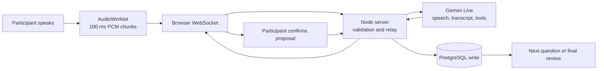

# Workflow performance and token accounting

**Updated 17 November 2026.** This document describes the local implementation. The complete [architecture and workflow diagrams](PROTOTYPE_ARCHITECTURE.md) show the functional path. No production latency or per-session Gemini token telemetry has been collected by this prototype.

## Data path and latency points



| Stage | What the code does | What is measured today |
| --- | --- | --- |
| Summary suggestion | Reads synthetic JSON and applies local rules | No Gemini tokens; no recorded wall-clock duration |
| Doctor conversation | Retrieves candidate forms, sends de-identified context and note to the configured text model, checks returned IDs | Model request not instrumented for tokens or latency; request timeout is 25 seconds |
| Prescription | Writes an assignment in the configured database | No Gemini tokens; no recorded database timing |
| On-screen assessment | Validates and persists entered answers | No Gemini tokens; no recorded end-to-end timing |
| Voice capture | Browser sends 16 kHz, 16-bit mono PCM to Node | Each worklet chunk is 1,600 samples, or 100 ms of audio |
| Optional camera | Browser encodes 640 × 360 JPEG at quality 0.55 every 1.1 seconds when enabled | Actual JPEG size and visual tokens vary; frames are context only |
| Gemini Live | `@google/genai` relays audio, optional frames, input/output transcription, and tool calls | First-audio and full-turn latency are not recorded |
| Confirmation | Validates current item and proposed value; writes only after explicit confirmation | Human response time and DB round trip are not recorded |
| Final review and report | Saves corrections and runs deterministic score code | No Gemini tokens; no recorded scoring or report timing |

The audio worklet generates **3,200 raw bytes per chunk** (1,600 samples × 2 bytes) or about **32 KB/s** before WebSocket overhead. The browser-to-Node packet adds a one-byte type marker. Node sends the PCM to the Gemini SDK. Playback uses 24 kHz, 16-bit mono PCM, about **48 KB/s raw** while Gemini speaks, before transport encoding and overhead. These are **media byte rates, not token counts or network measurements**.

The camera timer allows at most about **0.91 attempted frames/s** and skips frames when the socket is backed up or an encoded frame is too large. File size depends on the scene. Video does not set answers or change scores.

The Live bridge requests input and output transcription, uses sliding-window context compression, and offers session resumption when Gemini returns a handle. On a dropped connection it schedules up to three reconnects at 1, 2, and 3 seconds. Those are configured delays, not observed service response times.

## Token and cost status

| Activity | Gemini use |
| --- | --- |
| Structured summary rules and initial shortlist | None |
| Searchable catalogue filtering and local fallback | None |
| Doctor conversation | Text-model tokens when used |
| On-screen assessment | None |
| Voice conversation | Live input/output audio, prompt text, transcriptions, tool turns, and optional image input |
| Final scoring, persistence, and report rendering | None |

The server does **not** save Gemini `usageMetadata` or a per-session modality breakdown. Consequently, there is no verified number of tokens, provider charge, or average latency per assessment in this repository. A rough estimate based only on audio seconds would omit repeated context, text, transcription, optional video, and provider billing details. Do not present one as an actual measured cost.

To measure a real session, capture the provider's usage metadata for every Live and Doctor conversation response and tag it with a non-identifying session ID. Record monotonic timestamps at: microphone start, user speech end, first model audio, answer proposal, participant confirmation, successful DB write, and first audio for the next question. Then calculate:

```text
first_audio_latency = first_model_audio - user_speech_end
proposal_latency    = answer_proposal - user_speech_end
next_question_delay = next_question_audio - confirmation
session_cost        = sum(provider_reported_tokens_by_modality × current_rate_by_modality)
```

Use the provider's current billing data to reconcile cost; do not infer price from the local media byte rate. Keep measurement logs free of patient names, spoken content, credentials, and raw media.

## Current performance risks and useful checks

1. A long conversation accumulates context and may increase model work; the bridge requests context compression but does not expose its savings.
2. Each answer can require a model proposal, a human confirmation, a database write, and the next model turn. The human and remote-model stages dominate perceived delay but have not been quantified here.
3. PostgreSQL adds a remote round trip to each persisted operation. The backend is visible at `GET /api/health`; no runtime database latency benchmark has been collected in this project.
4. Compare the same form, language, device, network, and camera setting when measuring sessions. Different item counts and clarification turns make raw total duration misleading.

Run `npm test` for functional coverage. It verifies scoring and state transitions, not real-time speech quality, provider latency, token cost, or clinical validity.
