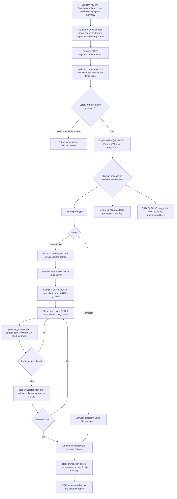

# Assessment workflow and performance map

**Scope:** the current local PHQ-9 prototype, including the assessment suggestion screen, optional Gemini Live conversation, final review, and report. **As implemented on 12 November 2026.** This is not a diagram of the deployed Casebook application. The prototype does not connect to Casebook or DynamoDB; the clinician manually selects de-identified concerns after reviewing the patient record.

## Technical path and time contributors

| Stage | Current implementation | Time or throughput observation |
|---|---|---|
| Recommendation | `POST /api/recommendations` runs local JavaScript rules; no database or model call | No measured latency; expected to be small relative to a Live round trip. **0 Gemini tokens.** |
| Form-test mode | Browser sends selected answer to local Node WebSocket; SQLite stores each confirmed answer | **0 Gemini tokens.** Local write latency is not instrumented. |
| Microphone capture | Browser AudioWorklet resamples to mono, signed 16-bit PCM at **16,000 samples/s** | Sends **1,600 samples every 100 ms**: 3,200 raw bytes/chunk, about 32 KB/s before WebSocket/base64 overhead. A full chunk adds up to 100 ms of capture buffering. |
| Camera, if switched on | Browser captures 640 × 360 JPEG at quality 0.55 every 1.1 s; server limits accepted frames to about 1/s | At most roughly **1 frame/s** into Gemini. JPEG bytes and visual tokens vary by scene and model processing. Camera is optional and must not determine scores. |
| Browser ↔ Node | Local WebSocket `ws://127.0.0.1:4174/ws` | Network loopback is usually small; no measured round-trip time. |
| Node ↔ Gemini | `@google/genai` Live session, audio output, input/output transcriptions, tool calls, context compression, session resumption | Remote network, turn detection, model response, tool exchange and speech synthesis dominate perceived delay. No measured first-audio or full-turn latency. |
| Gemini output | Streaming 24 kHz, 16-bit mono PCM in current browser playback code | About **48 KB/s raw** while Gemini speaks. Browser queues chunks for continuous playback. |
| Confirmation and next item | `propose_answer`, then user confirmation, `confirm_answer`, SQLite write, and another model prompt | Human confirmation and an additional model turn are intentional latency contributors. |
| Final review and report | User may edit all nine answers; Node scores 0–27 and saves revisions/result in SQLite | **0 Gemini tokens** for scoring, persistence and report rendering. No measured local timing. |

The code uses `contextWindowCompression: { slidingWindow: {} }` and a resumption handle when supplied by Gemini. On connection failure it retries up to three times after 1, 2 and 3 seconds, respectively. These are configured waits, **not measured response latency**.

## Tokens and cost

The recommendation rules, demo mode, final PHQ-9 scoring, and report generation use **zero Gemini tokens**. Only Live mode sends text, microphone audio, optional video frames, and receives audio/transcriptions/tool responses.

Google documents approximately **25 audio tokens per second** for Live input, with the active context charged again on later turns. The app currently enables both input and output transcription, which can add text-output token charges. It does **not** record `usageMetadata`, so there is no defensible measured total for a completed assessment. [Google Live best practices](https://ai.google.dev/gemini-api/docs/live-api/best-practices), [Live token metadata](https://ai.google.dev/gemini-api/docs/live-api/capabilities#token-count).

**Worked illustration, not an actual bill:** suppose one PHQ-9 session contains 5 minutes of streamed microphone audio, 3 minutes of Gemini speech, and the camera stays off. At 25 audio tokens/s, that is about **7,500 newly supplied input-audio tokens** and **4,500 generated output-audio tokens**. Google currently lists Gemini 3.8 Live paid standard rates of **$3 per million input-audio tokens** and **$12 per million output-audio tokens**. The simple one-pass media arithmetic is `7,500 × $3 / 1,000,000 + 4,500 × $12 / 1,000,000 = $0.0765`. **This is not an end-to-end session estimate:** it excludes repeated context billing, prompt/tool text, transcription text, any thinking tokens, optional video, and provider-side accounting. A real session can cost more. [Google Gemini pricing](https://ai.google.dev/gemini-api/docs/pricing#gemini-3.8-live), [Live billing behavior](https://ai.google.dev/gemini-api/docs/live-api/best-practices#pricing-billing).

| Quantity | How to obtain it accurately |
|---|---|
| Actual input/output/total tokens | Capture each Live server message's `usageMetadata` and its modality breakdown; reconcile with provider billing. This prototype does not yet do so. |
| Actual cost per assessment | Apply the active model's current rates to provider usage and billing data, including repeated context and transcription. |
| First-audio latency | Record monotonic timestamps at user speech end and first Gemini audio chunk. Not currently measured. |
| Full-turn latency | Record speech end, proposal, confirmation, next question first audio and end. Not currently measured. |
| Recommendation latency | Time `POST /api/recommendations` from browser to response; not currently measured. |

**Performance interpretation:** 100 ms microphone chunks create a known capture interval. All other latency figures require a timed session on the actual device, network and account. The nine-question duration depends strongly on how long the participant speaks and how often Gemini asks clarifying questions.

## Source map

- `src/recommendation.js` — structured, deterministic suggestion rules.
- `src/server.js` — HTTP endpoints, local WebSocket, Gemini bridge setup, result endpoints.
- `public/audio-worklet.js` and `public/app.js` — capture, frame sending, playback and on-screen review.
- `src/gemini-bridge.js` — Live model configuration, exact question prompts, propose/confirm/cancel tools, stream relay.
- `src/store.js` and `src/assessment.js` — SQLite, answer revisions, deterministic score and item-9 follow-up flag.

Clinical questionnaire selection remains a clinician decision. A positive PHQ-9 item 9 response triggers a human follow-up flag; the prototype does not notify a clinician automatically.
